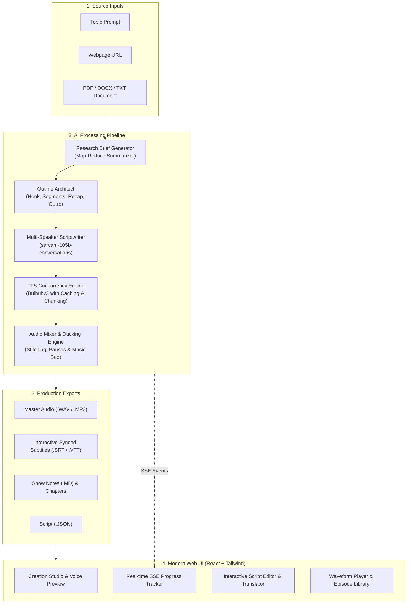

# PodcastAI: AI Podcast Studio Powered by Sarvam AI

PodcastAI is a production-quality, end-to-end AI Podcast Generator built with the **Sarvam AI API** suite:
* **Dialogue & Outlining**: Sarvam LLMs (`sarvam-105b-conversations` and `sarvam-105b`) for research synthesis, structured outlining, and natural conversational dialogue generation.
* **Text-to-Speech**: **Bulbul:v3** & **Bulbul:v4-flash** for multi-speaker voice synthesis across English and all 11 scheduled Indian languages.
* **Localization**: **Sarvam Mayura** and **Sarvam Translate** for one-click script translation and re-synthesis.
* **Audio Engineering**: Silence trimming, peak/RMS normalization, natural conversational pause insertion, background music bed mixing, and audio ducking.

---

## Architecture Diagram



---

## Features

1. **Multi-Speaker Synthesis**: Supports 1 speaker (monologue), 2 speakers (host & co-host), and 3 speakers (host, co-host, guest expert) with natural conversational interruptions and reactions.
2. **Grounded Research Engine**: Extracts articles from URLs, PDFs, and DOCX files with a map-reduce summarization pipeline to avoid context truncation.
3. **Indic & Multilingual First**: Built-in native support for Indian English (`en-IN`), Hindi (`hi-IN`), Bengali (`bn-IN`), Tamil (`ta-IN`), Telugu (`te-IN`), Kannada (`kn-IN`), Malayalam (`ml-IN`), Marathi (`mr-IN`), Gujarati (`gu-IN`), Punjabi (`pa-IN`), and Odia (`od-IN`).
4. **Interactive Script Editor**: Review and edit any dialogue turn, adjust per-turn pause gaps, delete/add turns, or translate the episode and re-synthesize.
5. **Intelligent Caching**: All synthesized turns are cached via SHA256 hashes of `(text, voice, language, pace, model)`. When a single turn is modified, only that turn is re-billed.
6. **Broadcast Audio Mastering**:
   - Automatic silence trimming and normalization.
   - Music ducking (background music drops 80% in volume whenever speakers talk).
   - Generates SRT and VTT subtitles synced down to the millisecond.

---

## Quickstart

### Prerequisites
* Python 3.11+
* Node.js v18+ and npm
* A Sarvam AI API Key (https://dashboard.sarvam.ai)

### 1. Local Setup

```bash
# 1. Clone or navigate to the repository
cd KIVI

# 2. Configure environment
cp .env.example .env
# Edit .env and paste your SARVAM_API_KEY:
# SARVAM_API_KEY=sk_...

# 3. Install backend dependencies
pip install -r requirements.txt

# 4. Install and build frontend
cd frontend
npm install
npm run build
cd ..

# 5. Start the server
uvicorn app.main:app --host 0.0.0.0 --port 8000
```
Open your browser at `http://localhost:8000`.

---

### 2. Docker Setup

To run the entire stack with Docker:

```bash
# Ensure .env is populated with your SARVAM_API_KEY
docker-compose up --build
```
Access the application at `http://localhost:8000`.

---

## Generating Sample Episodes (CLI Demo Mode)

You can run the built-in demo generator to produce 1-minute 2-speaker podcast samples in English and Hindi:

```bash
# Generate both English and Hindi sample episodes into samples/
python -m app.demo --lang all

# Or individually:
python -m app.demo --lang en
python -m app.demo --lang hi
```

The output will be saved to:
* `samples/sample_english.wav` (with `samples/sample_english.srt`)
* `samples/sample_hindi.wav` (with `samples/sample_hindi.srt`)

---

## Running Tests

All unit tests are located in `tests/`:

```bash
python -m pytest tests/ -v
```

Test coverage includes:
* Pydantic schema validation & stage-direction sanitization (`test_script_validation.py`)
* Sentence boundary chunking for text limits (`test_chunking.py`)
* Audio processor, silence trimming, loudness normalization, and audio mixing (`test_audio_mixer.py`)
* Mocked Sarvam API client with retry logic on 429 and exponential backoff (`test_sarvam_mock.py`).

---

## API Reference

| Endpoint | Method | Description |
|---|---|---|
| `/api/episodes` | `POST` | Create a new podcast generation job |
| `/api/episodes` | `GET` | List all episodes in history |
| `/api/episodes/{id}` | `GET` | Get single episode details |
| `/api/episodes/{id}/events` | `GET` | Server-Sent Events (SSE) progress stream |
| `/api/episodes/{id}/script` | `PUT` | Update modified dialogue script |
| `/api/episodes/{id}/synthesize` | `POST` | Re-synthesize audio for updated script |
| `/api/episodes/{id}/translate` | `POST` | Translate script to another language & re-synthesize |
| `/api/episodes/{id}/export?format=...` | `GET` | Download WAV, MP3, SRT, VTT, MD, or JSON |
| `/api/voices` | `GET` | Catalog of Bulbul voices and language options |
| `/api/voices/preview` | `POST` | Generate 1-sentence audio preview for a voice |
| `/api/voice-profiles` | `GET`/`POST` | Manage persistent custom voice profiles |
| `/api/health` | `GET` | System health check and API key validation |

---

## License
MIT License. Built for Sarvam AI developer integrations.

